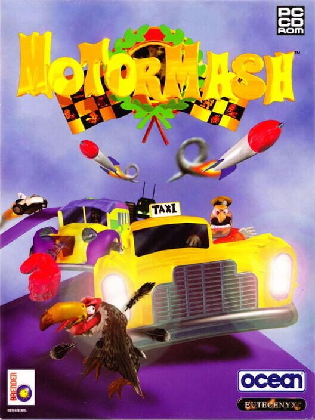
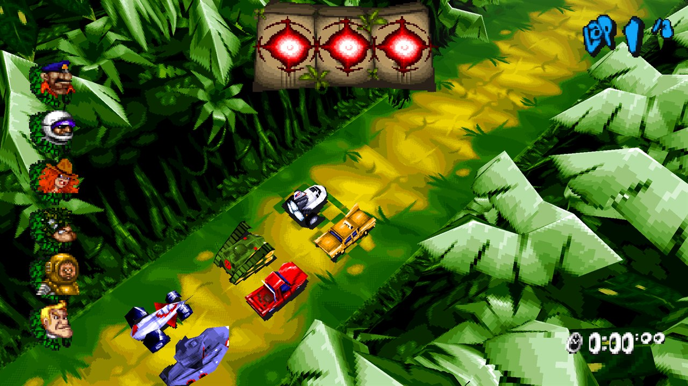
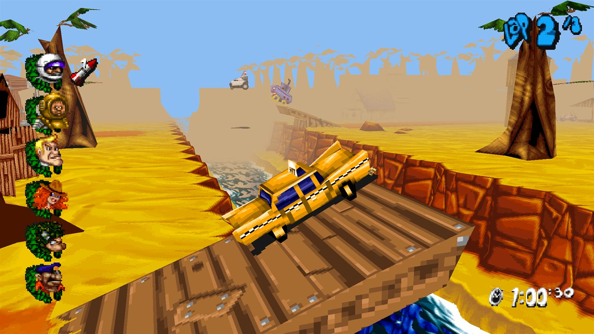
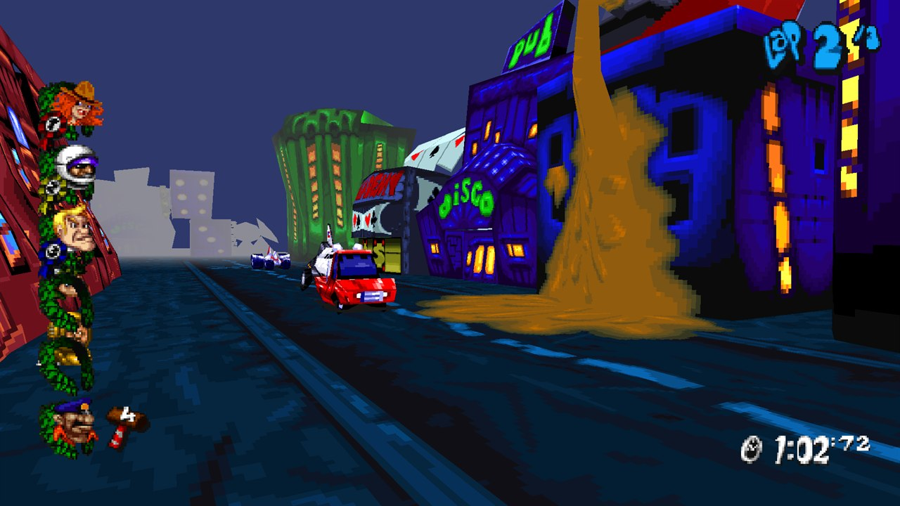
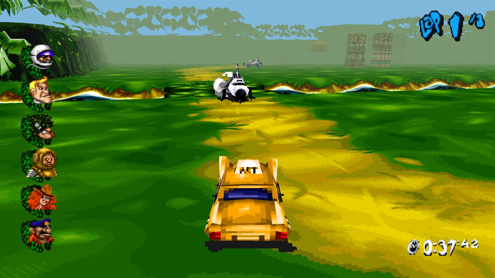
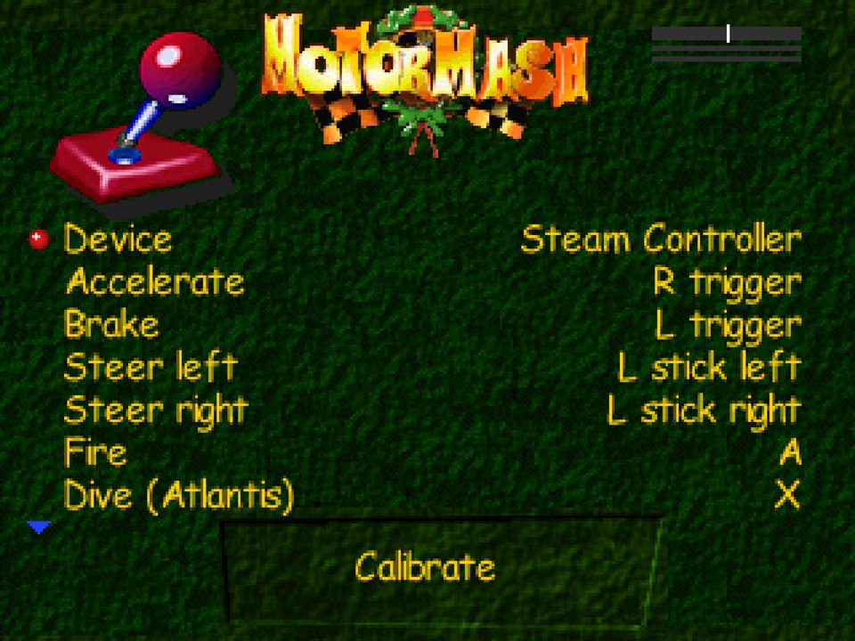
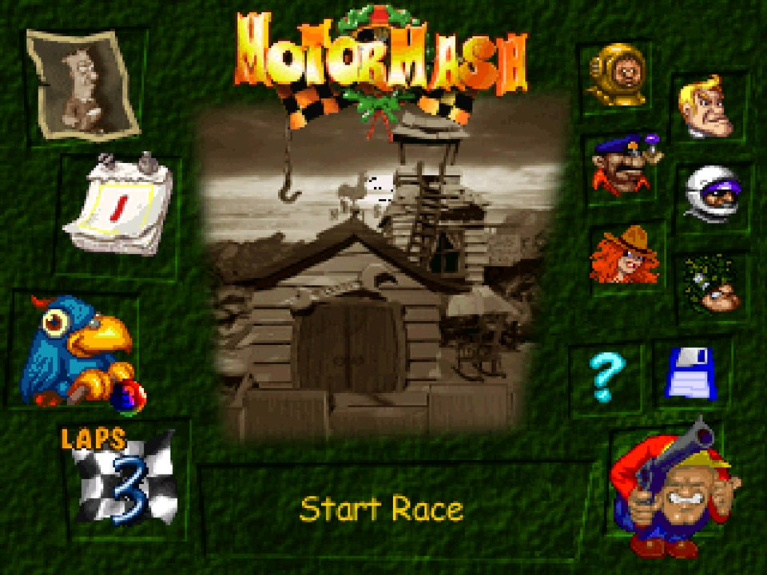

# Motor Mash: ReMashed

<p align="center">
  
</p>

*(formerly "Motor Mash for Windows 10/11")*

**ReMashed** is a fan patch that gets **Motor Mash** (Eutechnyx / Ocean, 1998) running properly
on Windows 10 and 11. It adds a long list of improvements: smooth high-refresh-rate rendering,
native modern controllers with true analog driving, new race cameras, six-car races,
difficulty settings and more.

> **You need your own copy of the game.** This project contains no game files (only the box
> art and screenshots on this page). The installer uses your own Motor Mash CD (or an image of
> your disc) to install and patch the game.

> **Made with AI, guided by a human.** The code and documents here were written by Anthropic's
> Claude (about 96.5% Claude Opus 5.5, 3.5% Claude Haiku 5.5). The project's author directed
> the work, playtested it, and approved every change. Details: [AI.md](AI.md).

## Screenshots

Taken in ReMashed at 1920×1080 with the Vulkan renderer.

<table>
  <tr>
    <td></td>
    <td></td>
  </tr>
  <tr>
    <td align="center">Six-car races</td>
    <td align="center">Widescreen at your monitor's refresh rate</td>
  </tr>
  <tr>
    <td></td>
    <td></td>
  </tr>
  <tr>
    <td align="center">The City at night</td>
    <td align="center">Amazon, with the optional distance fog</td>
  </tr>
  <tr>
    <td></td>
    <td></td>
  </tr>
  <tr>
    <td align="center">Controller Setup: native modern controllers</td>
    <td align="center">The original menus, as they were</td>
  </tr>
</table>

---

## Download and install

1. Download **`MotorMashPatch.exe`** from the [Releases](../../releases) page.
2. Do one of the following:
   - **Game not installed yet:** insert the Motor Mash CD (or mount an image of it), run
     `MotorMashPatch.exe` and choose **I** (install). It copies the game to
     `C:\Games\Motor Mash` (or a folder you choose) and sets everything up.
   - **Game already installed:** copy `MotorMashPatch.exe` into the game folder (the one with
     `MotorMsh.exe`) and run it. Have the CD in the drive the first time.
3. Start the game with `MotorMsh.exe` (the installer can create a desktop shortcut).

After that the CD is **no longer needed**.

What the installer does:
- checks that `MotorMsh.exe` is the original 1998 release and keeps it as
  `MotorMsh.exe.original`
- patches `MotorMsh.exe` and installs the port's files (`MMCDA.dll`, `SDL3.dll`, dgVoodoo2)
- copies the DirectX 5 Retained Mode files (`d3drm.dll` and friends) from **your CD**.
  Windows 10/11 no longer has them, and they are why the original won't start.
- rips the game's CD music to `Music\TrackNN.wav` from **your CD**

Options:

| Command | What it does |
|---|---|
| `MotorMashPatch.exe /image "D:\Images\Motor Mash.cue"` | Use a `.cue`/`.bin` image of your disc instead of a drive |
| `MotorMashPatch.exe /cd E:` | Use a specific CD drive |
| `MotorMashPatch.exe /install "D:\Games\Motor Mash"` | Install to this folder without asking |
| `MotorMashPatch.exe /restore` | Undo the patch: put back the original exe and remove the patch DLLs |

Running it again on a patched game updates the patch files and keeps your settings.

---

## Everything this patch adds

### Runs on modern Windows
- Starts and runs on **Windows 10 and 11**. The original needs DirectX 5 Retained Mode
  (`d3drm.dll`), which modern Windows doesn't include.
- **Fixes the crash at race start** (a graphics surface was released twice).
- **No CD needed:** the CD music is played from ripped audio files by a built-in emulation of
  the old Windows CD audio player, including the in-game music volume.
- Modern rendering through **dgVoodoo2** (DirectDraw/Direct3D on any modern GPU).
- **No more flickering or black blocks** on screen: every frame is fully cleared and fully
  presented.
- The game window fits your screen (borderless, centred, correct aspect), with black side
  panels in 4:3 modes.
- **Widescreen resolution** (1024×576 by default) in place of the old 800×600 option. The display
  mode list is cleaned up so the useful modes are all offered.
- **No black flash** when the game switches display modes between menus and races: the last
  frame stays on screen until the new mode is ready.
- **Higher far clipping** so raised cameras don't cut off the track.

### New Vulkan renderer (default)
- The game's 3D and 2D now draw through a **new Vulkan renderer** written for this port. It
  matches the original look (same lighting, colours and back-face culling), runs the
  interpolated frames at your refresh rate, and uses **exclusive fullscreen** in races for
  even frame pacing.
- The **original renderer** (D3DRM through dgVoodoo2) is still there: **Options > Display >
  Renderer** switches between Original and Vulkan (applies at the next start), like the
  original game's separate DOS and DirectX versions. A PC without a working Vulkan driver
  uses the original renderer automatically.
- Extras (F10 debug menu, or `mmcda.ini`): **smooth texture filtering** (off by default; the
  original and the PS1 version both draw sharp texels) and **distance fog** per world, which
  the original game never used.
- The **race loading screen** (track, lap record, the starter firing his gun) is laid out as
  in the DOS version and stays on screen for a moment after the shot.

### Smooth motion at your monitor's refresh rate
- **Frame interpolation:** the game logic still runs at its original fixed rate, but every
  moving object is blended between ticks, so races render smoothly at 60/120/144 Hz or more.
- **Refresh-locked pacing:** each game tick is locked to a whole number of screen refreshes for
  perfectly even frames (for example 4 refreshes per tick at 120 Hz).
- Smooth movement for cars hit by weapons, firing animations, pickups and track objects. The
  floating world origin and teleports are handled so nothing jumps.

### Modern controllers (native, no Steam needed)
- **Native controller support through SDL3:** Xbox, PlayStation, Nintendo Switch, generic pads
  and the **2026 Steam Controller**, which is switched out of keyboard/mouse mode without Steam
  running.
- **True analog driving:** proportional steering, throttle and brake, each switchable back to
  the original digital on/off behaviour.
- **Controller Setup screen**, opened with the menu's **Calibrate** option (it used to launch the
  Windows joystick panel behind the game). Settings:
  - controller to use
  - button binding (press to bind) for accelerate, brake, steer, fire, dive and pause
  - dead zone
  - steering and throttle: analog or digital
  - body lean amount
  - ride height
  - game speed
  - track unlocking
  - reset to defaults
- **Menus and races use separate controls.** Your bindings (above) apply in races only, so a
  trigger or the dive button can't select or move things in the menus:

  | | Menus | Races |
  |---|---|---|
  | Move | D-pad or left stick | your steering binding |
  | Select | A | (accelerate and fire as bound) |
  | Back | B | — |
  | Pause / Esc | Start (☰) | Start, or your pause binding |
  | Triggers, X, other race bindings | do nothing | as bound |

  The Controller Setup screen itself uses the same menu controls.
- If the Steam Controller is switched on after the game starts, or wakes from sleep, its
  keyboard/mouse mode is turned off again on its first input, so presses aren't doubled.
- Touch-sensitive sticks and grips (Steam Controller) are ignored, so a light touch doesn't
  press anything.
- The control choice at start-up keeps the original meaning: the purple and pink lumps are the
  two keyboard layouts, and the joystick icon is the controller.

### Better-looking cars
- **Smooth turning:** cars rotate with the game's full 1024-step heading instead of visible
  2.8° steps.
- **Body lean fixed:** the original leaned cars about the world's axis, so the lean was reversed
  or became pitch depending on which way you faced. Cars now lean correctly in every direction,
  and the amount is adjustable.
- **Shadows stay flat on the ground** instead of tilting with the car body.
- **Lowered ride height** (optional, default on): cars sit on the road instead of floating above
  it, including while firing or transformed by a weapon.
- **Models rotate around their centre:** cars and spinning pickups no longer turn around an
  off-centre point.

### New race cameras
Press **Select** on the controller or **F7** to cycle through:
- **Original:** the game's camera. The right stick raises or lowers it (as PageUp/PageDown do).
- **Chase:** loosely follows behind the car. The right stick looks left, right or behind.
- **Bumper:** mounted on the front of the car. The right stick looks around.
- **Top-down:** straight down over the car. The right stick zooms.
- **TV:** fixed trackside cameras that track and zoom as you pass, cutting from one to the next.

Each world gets its own sky colour, and the cameras never dip below the ground. The original
camera can also be zoomed with **PageUp/PageDown** (**Home** resets it).

### Six-car races
- **Up to 6 racers** in Single Race and Practice, instead of 4.
- **Two new racer slots** on the main menu, in frames added to the menu art above the top two
  portraits. Press Enter on a slot to cycle Random, any free character, or None. One slot set to
  None gives a 5-car race; both give the original 4.
- The race code is extended for 6 cars:
  - ranking and finish order
  - car-to-car collisions
  - CPU catch-up and weapon aiming
  - lap timing
  - per-car sounds
  - lifts and teleporters (which used to grab the wrong car)
- **HUD for 6:** six portraits spaced to fit the screen, and **new 5th (purple) and 6th (grey)
  finishing rosettes**.
- League, Knockout, Beat The Clock and Team Play stay at 4 cars, as designed.

### Difficulty (game speed)
Controller Setup → **Game speed**:
- **Easy (20)**: 20 game ticks per second, about how fast the game ran on typical 1998 PCs
- **Medium (25)**: the PlayStation PAL version's speed (default)
- **Hard (30)**: the PC version's full speed on a fast machine

Everything in a race slows together (cars, CPU drivers, weapons, timers) while handling and
jumps stay exactly the same, and motion stays smooth.

### Unlock all tracks
Controller Setup → **Tracks: All unlocked** makes every track selectable straight away. Your
saved lap records are not changed, so switching back locks them again. Normally you start with
2 tracks per world and unlock the rest by setting lap records.

### HUD
- **HUD scaling:** the race HUD (portraits, lap counter, timer) can be drawn at a chosen size,
  pinned to the screen edges or as one centred block (`mmcda.ini [hud] scale / anchor`).

### Debug menu (F10)
- Load **any track** (including locked ones) for the next race.
- Draw distance, an overview camera and other testing helpers.
- Renderer extras: texture filtering, fog, and showing back faces (to see the models from inside).

---

## Settings file

Settings are saved in `mmcda.ini` in the game folder. Most are changed in game through
Controller Setup. Useful entries:

```ini
[race]
cars=6            ; 4 turns the extra racers off
speed=medium      ; easy | medium | hard
tracks=normal     ; all = every track unlocked
[car]
lean=100          ; body lean, percent
lowered=1         ; 1 = cars sit on the road
[hud]
scale=4           ; HUD size (or fit)
anchor=edges      ; edges | center
[camera]
zoom=1.3          ; original camera height
[render]
backend=vulkan    ; vulkan | original (also Options > Display > Renderer)
filter=sharp      ; sharp | smooth (Vulkan)
fog=off           ; on = distance fog (Vulkan)
exclusive=on      ; off = no exclusive fullscreen in races (Vulkan)
[display]
loadscreen=2.5    ; seconds the race loading screen stays after the shot
```

Environment variables for testing: `MMCDA_LOG=1` (writes `mmcda.log`), `MMCDA_NOINTERP=1`
(turns frame interpolation off), `MMCDA_VIEW=<0-4>` (starting camera).

---

## Building from source

Needs Visual Studio 2022 (C++ desktop, x86) and Python 3.

| Part | Folder | Build |
|---|---|---|
| Patch DLL (all features) | `tools/mmcda` | `cl /O2 /MT /LD /Ithird_party/vulkan/include mmcda.c /link /DEF:mmcda.def /OUT:MMCDA.dll winmm.lib user32.lib gdi32.lib dxguid.lib` (x86 developer prompt; the Vulkan renderer needs only the bundled headers, `vulkan-1.dll` comes with the graphics driver) |
| Installer / patcher | `tools/patcher` | `python build.py` (embeds MMCDA.dll, SDL3, dgVoodoo2) |
| Exe patch reference | `tools/patch_motormsh.py` | the byte patches the installer applies |
| Six-car relocation table | `tools/sixcars/gen_relocs.py` | regenerates `tools/mmcda/relocs.h` from a disassembly of your own `MotorMsh.exe` |
| VR tabletop viewer (experimental) | `tools/vrviewer` | `build.bat` (OpenXR, 64-bit) |

`dgVoodoo2_87_6.zip` is the original, unmodified dgVoodoo2 package; `build.py` extracts it.
`PORTING.md` holds the full reverse-engineering notes: addresses, structures, how each feature
works, and a comparison with the PlayStation version.

## Credits and licences

- **Motor Mash** © 1998 Ocean Software / Eutechnyx. This project is an unofficial fan patch and
  includes no game content. The box art and screenshots in `docs/images` belong to their owners
  and are shown only to identify the game.
- **dgVoodoo2** by Dege, shipped unmodified with this game mod as its readme allows.
- **SDL3**, zlib licence (`tools/mmcda/third_party/SDL3/.../LICENSE.txt`).
- **stb_vorbis** by Sean Barrett, public domain / MIT.
- **OpenXR loader** (VR viewer only), Apache 2.0.
